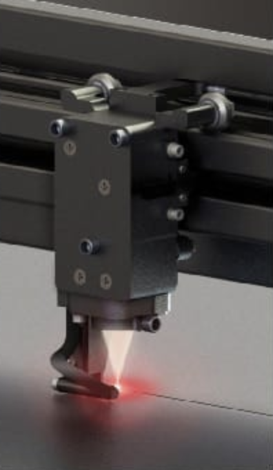
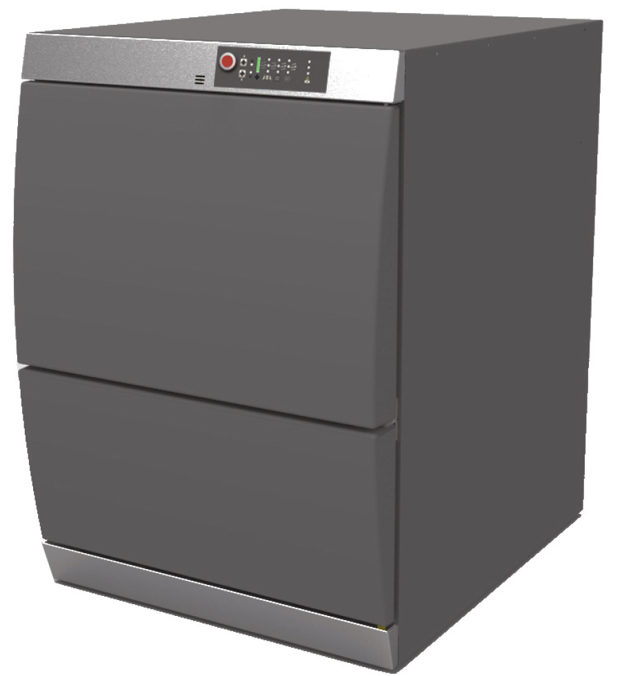
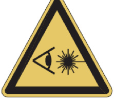
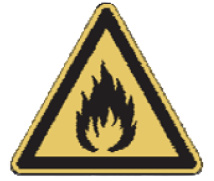
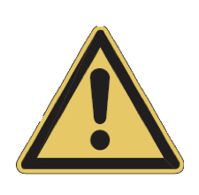
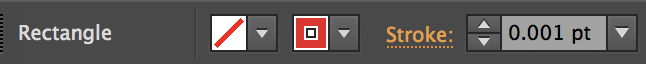
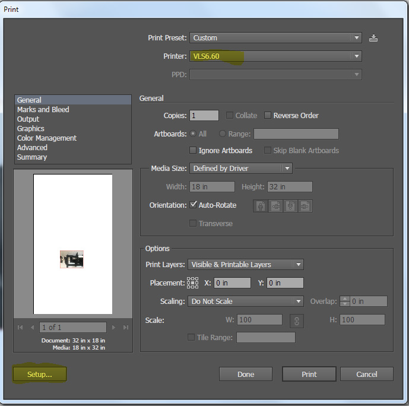
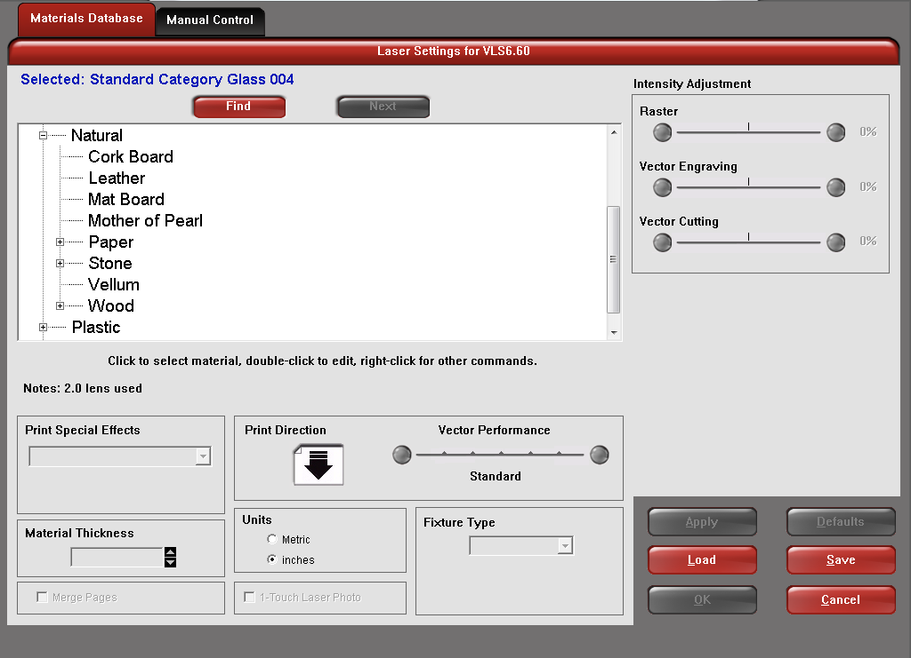
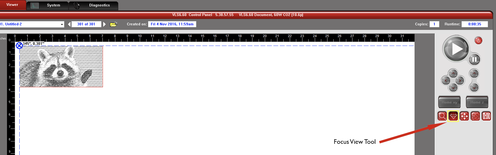
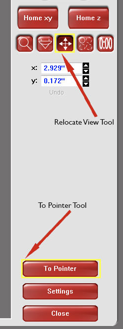

# Universal Laser Systems VLS 6.60

[← Back to the knowledge base](../README.md)

The VLS6.60 is a free-standing platform with a material processing envelope of 813 x 457 x 216 mm. The laser platform is equipped with a 10.6µm CO2 50-watt laser source.

### Optional Accessories installed

**Lateral Gas Assist Attachment**

The Lateral Gas Assist attachment is an adjustable attachment that can direct air along the material’s surface at a variety of incident angles. This is particularly helpful in raster engraving applications where debris can be removed from the engraving for ideal processing.

**UAC 4000 Filtration System**

The 4000 are an optional air filtration units designed to capture effluent (the gaseous composition of exhaust produced by laser material processing) when used as a companion device to ULS laser systems. The UAC cleans the air using a four-stage filtration system. The effluent is first brought into the air cleaning unit and pulled through a Pre-filter that removes large particulates. Next, the air is pulled through a HEPA filter to remove smaller particulates. Finally, the air is pulled through two Carbon filters, removing hazardous fumes such as Volatile Organic Compounds (VOCs). The UAC also actively monitors the environment for carbon monoxide (CO).

[read more here](https://www.ulsinc.com/discover-uls-innovations/air-filtration-units) about the UAC 4000

## How to use the laser cutter

### General Safety

Use of the equipment in a manner other than described in this guide or failure to follow the operational requirements and safety guidelines listed in this guide can result in injury to yourself and others and may cause damage to the equipment and our lab.

**It is required that you stay at the laser cutter at all times during operation.**

Exposure to the laser beam may cause physical burns and can cause severe eye damage. Proper use and care of this system are essential to safe operations.

**Never operate the laser system without constant supervision of the cutting and engraving process.**

Exposure to the laser beam may cause ignition of combustible materials which can lead to a fire. It is your responsibility to stay with the system through the entire cutting process.

**Never leave materials in the laser system after laser processing has finished.**

Always remove all the material including scrap material from the machine after use. Scrap material left in the laser system including materials that collect in the removable cutting table device can be a fire hazard. It is also recommended you allow scrap materials to cool prior to leaving the work area.

## Getting ready to cut

Create a new file in your favourite vector program and make sure that you use true black, red, and blue.

Make sure that the red line (cut line) is set to .001, In the example above the red lines go around the black areas of the cupcake. This is so the white areas will be cut out and the black areas will be engraved. You will need to place your picture inside of a red shape (rectangle, square, circle, oval) in this example we have used a square. Make sure that the shape that you chose to place your picture in has no fill.

Once you have your photo or Illustrator file setup, you can setup the printer for the material that you will be cutting or engraving. Click File > Print. In the print window, you want to make sure that the Printer selected is the VLS6.60. After that click print.

After that click the red icon in the icon tray in the bottom right of the screen. This will open up the VLS6.60 Control Panel. In this window, you will make the final adjustments before you cut out your design.

Now in the control panel, click the settings and select the appropriate settings for your materials.

In the Materials Database you will need to select the type of material that you will be using. The Materials Database has many different categories with a variety of materials under each category. To open a category, click the + sign.

Once you have selected your material you will need to enter the material thickness. To get the most accurate reading of the material thickness please use a caliper.

Next you will want to use the Focus View (indicated by the yellow square below) which is located in the tools panel on the right side of this software. Click in the top left corner of the screen. This lets the laser know where it should begin engraving and cutting.

Once the laser is in place you will need to make sure that your image is also in place. To do this, click the Relocate View Tool > Click To Pointer. (It’s the red button indicated by a yellow rectangle) This tool will move your design on the screen to where you focused the laser.

You Are now ready to engrave and cut on your material. Before you do so you may want to double check that your image is lined up with the laser one more time.

Before you press the big green button make sure that the compressor is on using the white remote and that air is coming out of the Lateral Gas Assist attachment

**Remember that if you think that something is wrong you can always stop the laser cutter by opening the door.**

# Resources

- [Universal-Laser-tutorial.pdf](../assets/vls-6-60/Universal-Laser-tutorial.pdf)
- [In-depth manual.pdf](../assets/vls-6-60/VLS_Platform_User_Guide.pdf)

How to clean it (only staff can perform this):

[How to properly maintain your laser](https://www.youtube.com/watch?v=pdL8AYSuel4)
