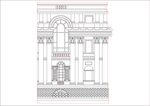
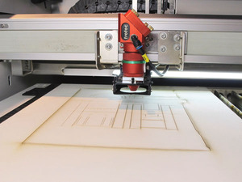
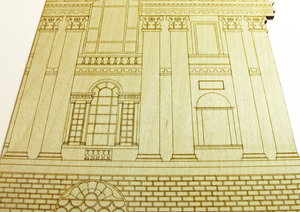

# Laser cutting

[← Back to the knowledge base](../README.md)

Laser Cutters are great tools offering the possibility to create many different things. From simple boxes to engraving detailed graphics into wood or building complex three-dimensional objects.

## What is a laser cutter?

A laser cutter is a computer controlled machine that uses a laser beam to precisely cut or engrave material. A laser is basically just highly focused, highly amplified light. The laser beam causes the material to locally burn, melt or vaporize. The kind of material that a laser can cut depends on the type of laser and the specific machine’s power.

The term “[Laser](https://en.wikipedia.org/wiki/Laser)” is an acronym for “Light Amplification by Stimulated Emission of Radiation”. Laser technology was developed in the 1960s.

There are different types of laser cutters. This guide will focus on CO2 lasers, as this type is most commonly used by hobbyists and the one we have in the lab. Other types are for example fiber or crystal lasers which are mostly used for industrial applications.

CO2 laser cutters are capable of cutting and engraving a wide range of non-metallic materials such as wood, paper, acrylic, textiles, and leather more on that later.

## How does a laser cutter work?

In a CO2 laser cutter machine, the laser beam is created in a tube filled with CO2 gas. Next, with the help of mirrors and lenses, the laser beam is directed to the laser head and focused on the material surface. Electronically controlled motors move the laser head to cut or engrave the desired shape into the material of the workpiece. The shape is defined by an input file which can be a vector or raster image.

When the laser hits the material, a very small area is heated in an extremely short period, causing the material to melt, burn or vaporize.

# What can you do with a laser cutter?

In general, there are three tasks that a laser cutter can perform: Cutting, Engraving and Marking.

### Cutting

When the laser beam goes all the way through the material of the workpiece it creates a cut. A laser cut is generally very precise and clean. The look of the cut edges depends on the material. For example, the edges of cut wood are typical of a darker brown than the original wood. The edges of acrylic do not change colour and have a nice glossy finish after laser cutting.

The kerf of a laser cutter is very small. The term kerf refers to the width of the groove made while cutting. This varies from material to material and is also dependent on the specific settings of the laser. For many materials, the kerf will be somewhere between 0.05 mm (0.002 in) and 0.5 mm (0.02 in).

### Raster Engraving

It is called raster or laser engraving when the laser beam removes parts of the top material but does not cut all the way through the material. It's a method of marking where the laser head engraves by moving from left to right slowly down the material.

Think of it like a printer where instead of printing, it is actually taking some of your material away to mark the surface. It reacts to difficult classes of materials in different ways. You can achieve some stunning results.

### Vector Engraving

Vector engraving is a method of marking or scoring a material surface. Like the laser cutting process the laser beam will follow the path of vector strokes without cutting all the way through. The width of the stroke is made at the kerf of the laser i.e approx 0.2mm. To engrave thicker strokes, we would need to use the raster engraving method

| | | |
|:-:|:-:|:-:|
|  |  |  |

# What materials can be cut or engraved with a laser?

CO2 laser machines are capable of cutting and engraving a variety of materials. However, there are also materials which cannot be processed. This may be because the laser can not cut through the material, or because toxic gases would form. Also, very flammable materials cannot be used.

Depending on the power and other specifications of the machine you are using, the maximal material thickness that can be cut will vary. The power of laser cutters is measured in Watt. Typical power levels range between 30 Watt and 120 Watt. The one we have in the lab is a 50 Watt laser.

| Material | Cut | Engrave | Comment |
|---|:-:|:-:|---|
| Cork | x | x | |
| Cotton | x | x | |
| Wood | x | x | |
| Granite | | x | |
| Glass | | x | |
| High-density polyethylene (HDPE) | (x) | (x) | Edges melt badly. Watch closely – easily catches fire. |
| Ceramic, Porcelain | | x | |
| Delrin (POM, acetal) | x | x | |
| Leather | x | x | Use vegetable-tanned for best results |
| Felt | x | x | |
| Cardboard | x | x | |
| Stone tiles | | x | |
| MDF | x | x | |
| Polypropylene (PP) | x | x | Melts somewhat |
| Slate | | x | |
| Paper | x | x | |
| Acrylic (Plexiglas) | x | x | |
| Plywood | x | x | Lasers can struggle to cut plywood sheets with exterior glue. Use plywood with interior glue. |
| Marble | | x | |

`x` = yes · `(x)` = possible, with care

### Materials that should not be cut or engraved with a laser

There are materials that should never be processed with a laser because this will lead to the creation of toxic gases or dust which can also damage the machine.

These materials include (but are not limited to):

- Leather and artificial leather that contains chromium (VI)
- Carbon fibers (Carbon)
- Polyvinyl chloride (PVC)
- Polyvinyl butyrale (PVB)
- Polytetrafluoroethylenes (PTFE /Teflon)
- Beryllium oxide
- Any material containing halogens (fluorine, chlorine, bromine, iodine astatine), epoxy or phenolic resins

# How to create a design for laser cutting or engraving?

Most CO2 laser cutters work very much like your everyday inkjet printer. The laser cutter comes with specific drivers which convert an image from a computer into a format that the laser cutter can read.

When working with laser cutters it is important to know the difference between vector images and raster images. Both image file types can be processed but raster images can only be used for engraving and not for cutting.

A vector image stores all the lines and colors as mathematical formulas. Raster images are pixel based. Which means that the image is made up of many small squares. Vector images can be scaled up without any loss in quality whereas raster images will start to “pixelate” at a certain enlargement.

**Vector file types:** SVG, EPS, PDF, DXF, DWG, CDR (CorelDRAW), AI (Adobe Illustrator)

**Raster file types:** JPG, PNG, GIF

## Here's a couple of resources to get you started on designing for laser cutting

- [How To Make Glue-less Interlocking Parts](https://www.ponoko.com/blog/how-to-make/how-to-make-glue-less-interlocking-parts/)
- [How To Design A Laser Cut Interlocking Box](https://www.ponoko.com/blog/design-ideas/how-to-design-a-laser-cut-interlocking-box/)
- [How To Make Laser Cut Interlocking Acrylic Designs](https://www.ponoko.com/blog/how-to-make/how-to-make-laser-cut-interlocking-acrylic-designs/)
- [Design a Living Hinge](https://www.ponoko.com/blog/how-to-make/how-to-design-a-living-hinge/)
- [10 Pro Tips to design for Laser Cutting](https://www.sculpteo.com/blog/2019/12/18/10-pro-tips-to-design-for-laser-cutting/)
- [CNC Panel Joinery Notebook](https://makezine.com/2012/04/13/cnc-panel-joinery-notebook/)
- [Laser Cutting Techniques and Projects](https://makezine.com/2013/10/23/tutorial-laser-cutting-techniques-and-projects/)
